# Entity–relationship diagram

<!-- Generated from prisma/schema.prisma by `npm run erd:generate`. Do not edit by hand. -->

Every tenant-owned table also has `tenant_id` → `tenants.id`, and every foreign key between
tenant-owned tables is composite `(tenant_id, …)`. Those `tenants` edges are omitted for
readability. Rules and CHECK constraints: [SCHEMA.md](SCHEMA.md).

```mermaid
erDiagram
  branches |o--o{ users : "branchId"
  users ||--o{ user_permission_overrides : "userId"
  categories ||--o{ menu_items : "categoryId"
  branches |o--o{ menu_items : "branchId"
  menu_items ||--o{ menu_item_ingredients : "menuItemId"
  inventory_items ||--o{ menu_item_ingredients : "inventoryItemId"
  inventory_items ||--o{ inventory_item_components : "mixedItemId"
  inventory_items ||--o{ inventory_item_components : "componentItemId"
  branches ||--o{ branch_stock : "branchId"
  inventory_items ||--o{ branch_stock : "inventoryItemId"
  branches ||--o{ inventory_transactions : "branchId"
  inventory_items ||--o{ inventory_transactions : "inventoryItemId"
  orders |o--o{ inventory_transactions : "relatedOrderId"
  users ||--o{ inventory_transactions : "actorId"
  branches ||--o{ inventory_snapshots : "branchId"
  inventory_items ||--o{ inventory_snapshots : "inventoryItemId"
  branches ||--o{ reconciliation_entries : "branchId"
  inventory_items ||--o{ reconciliation_entries : "inventoryItemId"
  inventory_transactions |o--o| reconciliation_entries : "adjustmentTransactionId"
  inventory_snapshots ||--o| reconciliation_entries : "snapshotId"
  users ||--o{ reconciliation_entries : "actorId"
  branches ||--o{ waste_entries : "branchId"
  inventory_items ||--o{ waste_entries : "inventoryItemId"
  inventory_transactions ||--o| waste_entries : "transactionId"
  users ||--o{ waste_entries : "actorId"
  branches ||--o{ orders : "branchId"
  order_workflow_stages ||--o{ orders : "stageKey"
  orders ||--o{ order_items : "orderId"
  menu_items ||--o{ order_items : "menuItemId"
  orders ||--o{ order_stage_history : "orderId"
  users |o--o{ order_stage_history : "actorId"
  app_environment {
    Int id PK
    AppEnvironmentName name
    DateTime created_at
    DateTime updated_at
  }
  tenants {
    uuid id PK
    String slug
    String name
    String timezone
    Boolean is_demo
    Boolean is_active
    DateTime created_at
    DateTime updated_at
  }
  branches {
    uuid id PK
    uuid tenant_id
    String name
    Boolean is_active
    DateTime created_at
    DateTime updated_at
  }
  users {
    uuid id PK
    uuid tenant_id
    uuid branch_id FK "nullable"
    String name
    String email "nullable"
    String password_hash "nullable"
    UserRole role
    Boolean is_active
    Boolean is_demo
    DateTime created_at
    DateTime updated_at
  }
  role_permissions {
    uuid id PK
    uuid tenant_id
    UserRole role
    String permission
    DateTime created_at
    DateTime updated_at
  }
  user_permission_overrides {
    uuid id PK
    uuid tenant_id
    uuid user_id FK
    String permission
    Boolean granted
    DateTime created_at
    DateTime updated_at
  }
  categories {
    uuid id PK
    uuid tenant_id
    String name
    Int position
    Boolean is_active
    DateTime created_at
    DateTime updated_at
  }
  menu_items {
    uuid id PK
    uuid tenant_id
    uuid category_id FK
    uuid branch_id FK "nullable"
    String name
    String description "nullable"
    Decimal_12_2 price
    MenuItemStatus status
    Boolean is_combo
    DateTime created_at
    DateTime updated_at
  }
  menu_item_ingredients {
    uuid id PK
    uuid tenant_id
    uuid menu_item_id FK
    uuid inventory_item_id FK
    Decimal_14_3 quantity
    Unit unit
    DateTime created_at
    DateTime updated_at
  }
  inventory_items {
    uuid id PK
    uuid tenant_id
    String name
    InventoryItemType type
    Unit unit
    Decimal_14_4 standard_unit_cost "nullable"
    Boolean is_active
    DateTime created_at
    DateTime updated_at
  }
  inventory_item_components {
    uuid id PK
    uuid tenant_id
    uuid mixed_item_id FK
    uuid component_item_id FK
    Decimal_14_3 quantity
    Unit unit
    DateTime created_at
    DateTime updated_at
  }
  branch_stock {
    uuid id PK
    uuid tenant_id
    uuid branch_id FK
    uuid inventory_item_id FK
    Decimal_14_3 current_stock
    Decimal_14_3 low_stock_threshold "nullable"
    Decimal_14_4 avg_unit_cost "nullable"
    DateTime created_at
    DateTime updated_at
  }
  inventory_transactions {
    uuid id PK
    BigInt seq
    uuid tenant_id
    uuid branch_id FK
    uuid inventory_item_id FK
    InventoryTransactionType type
    Decimal_14_3 quantity_delta
    Decimal_14_4 unit_cost "nullable"
    uuid related_order_id FK "nullable"
    uuid actor_id FK
    String note "nullable"
    DateTime created_at
    DateTime updated_at
  }
  inventory_snapshots {
    uuid id PK
    uuid tenant_id
    uuid branch_id FK
    uuid inventory_item_id FK
    Decimal_14_3 quantity
    BigInt through_seq
    DateTime taken_at
    DateTime created_at
    DateTime updated_at
  }
  reconciliation_entries {
    uuid id PK
    uuid tenant_id
    uuid branch_id FK
    uuid inventory_item_id FK
    Decimal_14_3 counted_quantity
    Decimal_14_3 expected_quantity
    Decimal_14_3 gap
    uuid adjustment_transaction_id FK "nullable"
    uuid snapshot_id FK
    uuid actor_id FK
    String note "nullable"
    DateTime created_at
    DateTime updated_at
  }
  waste_entries {
    uuid id PK
    uuid tenant_id
    uuid branch_id FK
    uuid inventory_item_id FK
    Decimal_14_3 quantity
    Unit unit
    String reason
    uuid transaction_id FK
    uuid actor_id FK
    DateTime created_at
    DateTime updated_at
  }
  order_workflow_stages {
    uuid id PK
    uuid tenant_id
    String key
    String label
    Int position
    Boolean cancellable
    Boolean deducts_inventory
    DateTime created_at
    DateTime updated_at
  }
  orders {
    uuid id PK
    uuid tenant_id
    uuid branch_id FK
    String stage_key FK
    DateTime canceled_at "nullable"
    PlacedByType placed_by_type
    uuid placed_by_id "nullable"
    Decimal_12_2 total
    String tracking_token_hash "nullable"
    String note "nullable"
    DateTime created_at
    DateTime updated_at
  }
  order_items {
    uuid id PK
    uuid tenant_id
    uuid order_id FK
    uuid menu_item_id FK
    String name
    Decimal_12_2 unit_price
    Int quantity
    Decimal_12_2 line_total
    DateTime created_at
    DateTime updated_at
  }
  order_stage_history {
    uuid id PK
    uuid tenant_id
    uuid order_id FK
    OrderHistoryAction action
    String from_stage_key "nullable"
    String to_stage_key "nullable"
    uuid actor_id FK "nullable"
    DateTime created_at
    DateTime updated_at
  }
```

## Enums

| Enum | Values |
| --- | --- |
| `AppEnvironmentName` | `local`, `test`, `staging`, `production` |
| `UserRole` | `ADMIN`, `MANAGER`, `WORKER` |
| `MenuItemStatus` | `ACTIVE`, `ARCHIVED` |
| `Unit` | `G`, `KG`, `ML`, `L`, `PCS` |
| `InventoryItemType` | `RAW`, `READY`, `MIXED` |
| `InventoryTransactionType` | `PURCHASE`, `CONSUMPTION`, `WASTE`, `TRANSFER`, `ADJUSTMENT` |
| `PlacedByType` | `STAFF`, `CUSTOMER`, `GUEST` |
| `OrderHistoryAction` | `PLACED`, `ADVANCED`, `CANCELED` |
